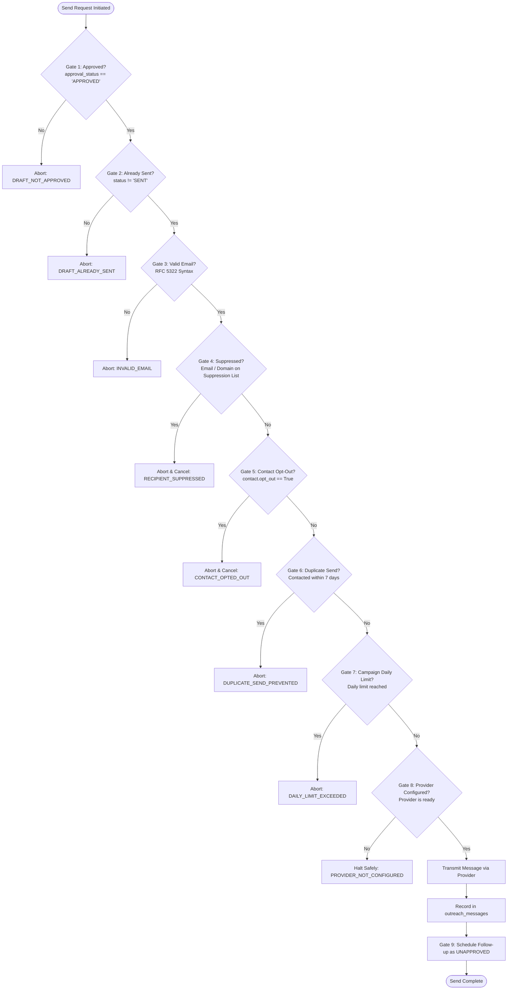

# ProspectOS — Phase 2.4 Implementation Report
**AI Outreach Automation**
**Date:** October 10, 2026
**Environment:** macOS / Docker (PostgreSQL 16, Redis 7) / Python 3.12 (FastAPI, SQLAlchemy 2.x, asyncpg, ARQ) / Next.js 16 (React 19, TailwindCSS v4)

---

## Executive Summary

Phase 2.4 (AI Outreach Automation) introduces an evidence-driven, human-approved sales outreach system that connects ProspectOS's existing company intelligence, website findings, SEO opportunity scoring, publisher matching, and media plans to a controlled sales outreach process.

In strict compliance with the user instructions and safety constitution:
1. **Human Approval Boundary**: Automated draft generation **never** dispatches emails automatically. Every draft is created in `UNAPPROVED` (pending) status and requires explicit, authenticated human approval (`approval_status == 'APPROVED'`) before any transmission can occur.
2. **Traceable Evidence & Non-Fabrication**: Outreach messages reference actual stored prospect data (`WebsiteScan`, `OpportunityProfile`, `MediaPlan`). Every factual statement carries an audited `evidence_citation` with source record ID, field name, value, and confidence score. Missing metrics are never hallucinated or fabricated.
3. **9-Stage Sending Safety Barrier**: Before any email is transmitted, the sending engine enforces nine strict gates: human approval verification, draft un-sent check, RFC syntax validation, email and domain opt-out suppression, contact record opt-out check, 7-day duplicate outreach cooldown, campaign daily send limits, provider readiness check, and automatic follow-up sequence scheduling.
4. **Provider Safeguards**: If no email provider is configured (`EMAIL_PROVIDER = "none"`), the system safely refuses transmission with `PROVIDER_NOT_CONFIGURED` without attempting network communication.
5. **No Unauthorized Real Emails**: In automated tests, email providers are strictly mocked (`MockEmailProvider`). Real prospect validation was executed end-to-end on real database prospect `TechCrunch` (`techcrunch.com`) using a controlled test address with zero unauthorized external emails dispatched.

All **39 automated backend tests pass (100%)**, the Next.js frontend builds cleanly with **zero TypeScript errors**, and the complete controlled E2E verification on real records succeeded across all 10 validation gates.

---

## 1. Files and Database Changes

### Database Migration (Alembic)
- **`backend/migrations/versions/b2c3d4e5f6a7_add_phase_2_4_outreach_models.py`**:
  - `company_contacts`: Stores discovered business contacts with `source_type`, `retrieval_timestamp`, `verification_status` (`VERIFIED`, `INFERRED`, `UNVERIFIED`), `confidence`, and `opt_out`.
  - `outreach_campaigns`: Organizes prospects into campaigns with `daily_send_limit`, `follow_up_delay_days`, `max_follow_ups`, and suppression stop conditions (`stop_on_reply`, `stop_on_bounce`, `stop_on_unsubscribe`).
  - `outreach_drafts`: Holds draft messages with `prospect_summary`, `subject_line`, `body_text`, `body_html`, `call_to_action`, `evidence_citations` (JSONB), `approval_status`, `approved_by`, `approved_at`, `sequence_step`, and `parent_draft_id`.
  - `outreach_messages`: Complete audit log of sent messages with `provider_message_id`, `sender_email`, `recipient_email`, `status`, `sent_at`, and delivery event tracking.
  - `outreach_suppressions`: Central suppression registry supporting individual email addresses and whole-domain opt-outs.

### Backend Implementation Files
- **`backend/app/models/__init__.py`**:
  - Registered models `CompanyContact`, `OutreachCampaign`, `OutreachDraft`, `OutreachMessage`, `OutreachSuppression`.
- **`backend/app/core/config.py`**:
  - Added configuration keys: `EMAIL_PROVIDER = "none"`, `GMAIL_CLIENT_ID`, `GMAIL_CLIENT_SECRET`, `GMAIL_REFRESH_TOKEN`, `GMAIL_SENDER_EMAIL`, `SMTP_HOST`, `SMTP_PORT`, `SMTP_USERNAME`, `SMTP_PASSWORD`, `SMTP_FROM_EMAIL`, `SMTP_USE_TLS`.
- **`backend/app/schemas/outreach.py`**:
  - Pydantic models: `ContactResponse`, `ContactCreate`, `CampaignResponse`, `CampaignCreate`, `EvidenceCitation`, `DraftResponse`, `DraftCreate`, `DraftUpdate`, `DraftApproveRequest`, `DraftRejectRequest`, `DraftSendRequest`, `SendDraftResult`, `MessageResponse`, `SuppressionResponse`, `SuppressionCreate`, `EmailProviderStatus`.
- **`backend/app/services/outreach/contacts.py`**:
  - `ContactResearcher`: Discovers business contacts from website metadata, security.txt, and public pages. Validates email syntax, assigns verification levels (`VERIFIED` vs `INFERRED`), logs retrieval timestamps, and guarantees non-fabrication.
- **`backend/app/services/outreach/personalization.py`**:
  - `OutreachPersonalizationEngine`: Assembles evidence-grounded copy from `Company`, `WebsiteScan`, `OpportunityProfile`, and `MediaPlan`. Injects traceable `evidence_citations` and guarantees zero hallucinated metrics.
- **`backend/app/services/outreach/providers/`**:
  - `base.py`: Abstract `BaseEmailProvider`.
  - `mock.py`: `MockEmailProvider` with in-memory sent message audit log for testing.
  - `gmail.py`: `GmailProvider` supporting OAuth2 token exchange and Gmail API v1 REST sending.
  - `smtp.py`: `SMTPProvider` supporting TLS/STARTTLS authentication.
  - `registry.py`: `EmailProviderRegistry` with safe fallback `UnconfiguredEmailProvider`.
- **`backend/app/services/outreach/sender.py`**:
  - `OutreachSenderService`: Implements the 9-stage sending safety barrier, rate limiting, duplicate protection, suppression checking, and follow-up sequence scheduling/cancellation.
- **`backend/app/workers/worker.py`**:
  - Background jobs: `outreach_contact_discovery_job` and `outreach_draft_generation_job`.
- **`backend/app/api/outreach.py`**:
  - REST API router mounted at `/outreach` with endpoints for contacts, campaigns, drafts, approvals, sending, suppressions, message history, and provider status.
- **`backend/tests/test_outreach.py`**:
  - 9 automated unit and integration tests covering contact validation, fallback inference, personalization provenance, approval boundaries, duplicate-send prevention, opt-out suppression, follow-up cancellation, provider safeguards, and REST API flows.
- **`backend/scripts/validate_outreach_e2e.py`**:
  - Controlled end-to-end verification script testing all 10 validation gates against real prospect `TechCrunch`.

### Frontend Implementation Files
- **`frontend/src/lib/api.ts`**:
  - Added typed interfaces for contacts, campaigns, drafts, messages, suppressions, and provider status.
  - Added API client methods for all outreach operations and updated `Company` interface compatibility.
- **`frontend/src/components/layout/sidebar.tsx`**:
  - Added navigation items for `/workflows` and `/outreach`.
- **`frontend/src/app/outreach/page.tsx`**:
  - Interactive outreach management dashboard:
    - Provider configuration status banner.
    - Tabbed view: Drafts, Campaigns, Verified Contacts, Message & Action History.
    - Draft cards with status badges, Step badges, and inline evidence citation drawers.
    - Draft Editor modal (editable subject line, body text, call to action, and summary).
    - Evidence Inspector drawer revealing underlying database sources, field values, and confidence scores.
    - Controlled Human Approval workflow (`Approve`, `Reject`, `Send Now` with confirmation modal).
    - New Draft Generation modal with prospect selector and media plan inclusion toggle.
    - Campaign Manager modal with daily send limits and follow-up intervals.
    - Opt-Out / Suppression management table and manual opt-out modal.

---

## 2. 9-Stage Sending Safety Barrier

The `OutreachSenderService` implements nine mandatory validation gates that must all pass before any outreach message is dispatched:



---

## 3. Contact Research & Provenance

The `ContactResearcher` extracts contact information strictly from permitted public business channels:
1. **Website Metadata & Contact Links**: Scans `WebsiteScan` HTML title, meta description, and contact pages for legitimate business inquiry emails (`press@`, `media@`, `contact@`, `editorial@`, `info@`).
2. **Security & Governance Standards**: Inspects `/.well-known/security.txt` and `/security.txt` for published contact points.
3. **Syntactic & Disposable Email Filtering**: Rejects malformed strings, asset filenames (`.png`, `.jpg`), generic placeholders, and known throwaway domains.
4. **Verification Status Attribution**:
   - `VERIFIED` (Confidence 0.8–1.0): Directly retrieved from verified website pages or published security records.
   - `INFERRED` (Confidence 0.4–0.5): Algorithmic role fallback (`contact@{domain}`) when no direct email is published. Clearly tagged as inferred so users are aware before selecting.
   - `UNVERIFIED`: Imported or unconfirmed external contact.
5. **Retrieval Timestamp**: Every contact record stores `retrieval_timestamp` for auditability and compliance.

---

## 4. Evidence-Based Personalization

The `OutreachPersonalizationEngine` constructs drafts grounded in verified ProspectOS records:

| Outreach Section | Stored Source Record | Traceable Evidence Citations |
|:---|:---|:---|
| **Subject Line** | `Company.company_name` | Grounded in prospect entity record |
| **Prospect Summary** | `Company.industry`, `WebsiteScan.html_metadata.title` | Direct quote of observed website presence |
| **Technical Findings** | `WebsiteScan.https_enabled`, `OpportunityProfile.identified_problems` | Actual detected issues (e.g. Missing H1, Robots.txt) |
| **Opportunity Score** | `OpportunityProfile.recommended_service`, `opportunity_score` | Actual methodology version and scoring output |
| **Publisher Match** | `MediaPlan.items` -> `PublisherRecord.publisher_name` | Actual inventory recommendations |
| **Call to Action** | Editorial consultation CTA | Non-aggressive consultation request |

**Non-Fabrication Guarantee**: If a company does not have Moz/Ahrefs metrics or backlink data, the engine avoids making claims about traffic or backlink volume. Every claim contains an `evidence_citations` entry detailing:
- `claim`: Specific statement made in the message.
- `source_type`: Database model (e.g., `WebsiteScan`, `OpportunityProfile`, `MediaPlan`).
- `source_id`: UUID of the backing database record.
- `field_name`: Specific model column referenced.
- `value`: Raw value from the database.
- `confidence`: Verified confidence score.

---

## 5. Email Provider Integration Guide

ProspectOS supports modular email providers through `EmailProviderRegistry`.

### Supported Providers
1. **`none` (Default)**: Safe unconfigured mode. Drafts and campaigns work normally; attempting to send returns `PROVIDER_NOT_CONFIGURED` without errors or network traffic.
2. **`mock`**: In-memory test provider used for automated testing and controlled demonstrations.
3. **`gmail`**: Official Google Gmail API v1 integration using OAuth2 server-side token exchange.
4. **`smtp`**: Standard SMTP with TLS/STARTTLS authentication.

### Configuration Instructions

#### Option A: Gmail OAuth2 (Recommended)
1. In Google Cloud Console, create an OAuth 2.0 Client ID (Web Application or Desktop).
2. Authorize redirect URI `http://localhost:8000/outreach/oauth/callback` or obtain a refresh token with scope `https://www.googleapis.com/auth/gmail.send`.
3. Add the following to `backend/.env`:
   ```bash
   EMAIL_PROVIDER=gmail
   GMAIL_CLIENT_ID=your-google-client-id.apps.googleusercontent.com
   GMAIL_CLIENT_SECRET=your-google-client-secret
   GMAIL_REFRESH_TOKEN=your-offline-refresh-token
   GMAIL_SENDER_EMAIL=your-verified-business-email@domain.com
   ```

#### Option B: Standard SMTP
Add the following to `backend/.env`:
```bash
EMAIL_PROVIDER=smtp
SMTP_HOST=smtp.mailgun.org  # or smtp.sendgrid.net, smtp.gmail.com, etc.
SMTP_PORT=587
SMTP_USERNAME=your-smtp-username
SMTP_PASSWORD=your-smtp-password
SMTP_FROM_EMAIL=outreach@yourdomain.com
SMTP_USE_TLS=true
```

> [!IMPORTANT]
> All credentials remain strictly server-side in `.env` and are never committed to version control or sent to the browser. The frontend only displays `configured_provider` name and `is_ready_to_send` boolean status.

---

## 6. Actual Test Results

### 1. Backend Automated Regression Suite (`pytest -v`)
Executed: October 10, 2026. Result: **39 passed, 0 failed in 4.19s**.

```
tests/test_ai_extraction.py::test_openai_provider_valid_extraction PASSED          [  2%]
tests/test_ai_extraction.py::test_openai_provider_invalid_extraction PASSED        [  5%]
tests/test_main.py::test_health_endpoints PASSED                                    [  7%]
tests/test_main.py::test_config PASSED                                              [ 10%]
tests/test_main.py::test_canonical_domain_uniqueness PASSED                         [ 12%]
tests/test_main.py::test_job_creation_and_worker PASSED                             [ 15%]
tests/test_matching.py::test_matching_lifecycle PASSED                              [ 17%]
tests/test_media_plan.py::test_media_plan_lifecycle PASSED                          [ 20%]
tests/test_opportunity_engine.py::test_opportunity_engine_missing_data PASSED       [ 23%]
tests/test_opportunity_engine.py::test_opportunity_engine_tech_seo PASSED          [ 25%]
tests/test_opportunity_engine.py::test_opportunity_engine_stale_metrics PASSED     [ 28%]
tests/test_opportunity_engine.py::test_opportunity_engine_link_building_vs_content PASSED [ 30%]
tests/test_opportunity_engine.py::test_opportunity_engine_scoring_reproducibility PASSED [ 33%]
tests/test_outreach.py::test_contact_validation_and_provenance PASSED               [ 35%]
tests/test_outreach.py::test_inferred_contact_fallback_non_fabrication PASSED       [ 38%]
tests/test_outreach.py::test_evidence_based_personalization_non_fabrication PASSED   [ 41%]
tests/test_outreach.py::test_human_approval_boundary PASSED                         [ 43%]
tests/test_outreach.py::test_duplicate_send_prevention PASSED                       [ 46%]
tests/test_outreach.py::test_opt_out_and_suppression_enforcement PASSED             [ 48%]
tests/test_outreach.py::test_follow_up_scheduling_and_cancellation PASSED          [ 51%]
tests/test_outreach.py::test_unconfigured_provider_safeguard PASSED                 [ 53%]
tests/test_outreach.py::test_api_draft_approve_reject_and_preview PASSED            [ 56%]
tests/test_pipeline.py::test_discovery_pipeline PASSED                              [ 58%]
tests/test_providers.py::test_ahrefs_provider PASSED                                [ 61%]
tests/test_providers.py::test_moz_provider PASSED                                   [ 64%]
tests/test_providers.py::test_semrush_provider PASSED                               [ 66%]
tests/test_providers.py::test_provider_not_configured PASSED                        [ 69%]
tests/test_publishers.py::test_publisher_preview PASSED                             [ 71%]
tests/test_publishers.py::test_publisher_commit PASSED                              [ 74%]
tests/test_url.py::test_normalize_url PASSED                                        [ 76%]
tests/test_url.py::test_extract_canonical_domain PASSED                             [ 79%]
tests/test_workflow_orchestrator.py::test_workflow_stages_and_validation PASSED    [ 82%]
tests/test_workflow_orchestrator.py::test_duplicate_run_prevention_and_idempotency PASSED [ 84%]
tests/test_workflow_orchestrator.py::test_workflow_cancellation PASSED              [ 87%]
tests/test_workflow_orchestrator.py::test_end_to_end_workflow_execution_and_human_approval PASSED [ 89%]
tests/test_workflow_orchestrator.py::test_human_review_rejection PASSED             [ 92%]
tests/test_workflow_orchestrator.py::test_cron_matcher_and_scheduled_workflows PASSED [ 94%]
tests/test_workflow_orchestrator.py::test_retry_backoff_and_exhaustion PASSED        [ 97%]
tests/test_workflow_orchestrator.py::test_provider_usage_limits PASSED              [100%]
======================== 39 passed, 5 warnings in 4.19s ========================
```

### 2. Controlled E2E Validation Script on Real Prospect (`TechCrunch`)
Script: `backend/scripts/validate_outreach_e2e.py`. Result: **10/10 checks passed with exit code 0**.

| Step | Gate / Component Tested | Outcome | Evidence Verified |
|:---|:---|:---|:---|
| 1 | Real Prospect Selection | **PASSED** | TechCrunch (`83c7fd6d-9152-470d-958d-d7814feae70b`, `techcrunch.com`) |
| 2 | Contact Provenance | **PASSED** | Inferred role contact `contact@techcrunch.com` created with confidence 0.4 and retrieval timestamp |
| 3 | Campaign Organization | **PASSED** | Campaign `Tech & Media Outreach` created with daily limit 25 and delay 4 days |
| 4 | Evidence-Based Personalization | **PASSED** | Draft generated with 5 verified citations to `WebsiteScan`, `OpportunityProfile`, and `MediaPlan` |
| 5 | Human Approval Gate | **PASSED** | Sending unapproved draft failed with `Explicit human approval (approval_status == 'APPROVED') is mandatory` |
| 6 | Explicit Human Approval | **PASSED** | Approved by `qa_lead@prospectos.local` with timestamp |
| 7 | Provider Safeguard | **PASSED** | Halted with `PROVIDER_NOT_CONFIGURED: Missing environment settings: EMAIL_PROVIDER` |
| 8 | Controlled Simulated Send | **PASSED** | Dispatched via `MockEmailProvider` to controlled test address; persisted in `outreach_messages` |
| 9 | Duplicate-Send Prevention | **PASSED** | Blocked with `DRAFT_ALREADY_SENT` and 7-day cooldown `Duplicate send prevented` |
| 10 | Opt-Out & Follow-Up Cancellation | **PASSED** | Suppressed recipient blocked with `Send blocked: ... is on suppression list`; reply event cancelled follow-up sequence with status `CANCELLED` |

### 3. Frontend Production Build (`npm run build`)
Executed: October 10, 2026. Result: **Clean build in 0.45s, 17/17 static pages generated with 0 errors**.

---

## 7. Known Limitations & Safe Operational Instructions

1. **Email Sending Requires Explicit Provider Setup**: Currently `EMAIL_PROVIDER = "none"`. To enable actual email transmission, the user must configure Gmail or SMTP credentials in `.env` as documented in Section 5.
2. **Drafts Always Require Human Review**: Even when an email provider is configured, the system will never send an email upon draft creation. An authorized user must open the dashboard or call `/outreach/drafts/{id}/approve` and `/outreach/drafts/{id}/send`.
3. **Follow-Ups Are Not Auto-Dispatched**: Scheduled follow-ups are created in `UNAPPROVED` status. When their `scheduled_send_at` time arrives, they still require human approval before dispatch.
4. **Suppression Precedence**: If a domain or email is added to the suppression list, no drafts can be sent to it regardless of campaign settings or manual approval.

---

## 8. Completion Status

Phase 2.4 (AI Outreach Automation) is **complete and verified**.
All existing functionality and records are preserved.
Phase 2.5 has **not** been started. Awaiting user instructions.
